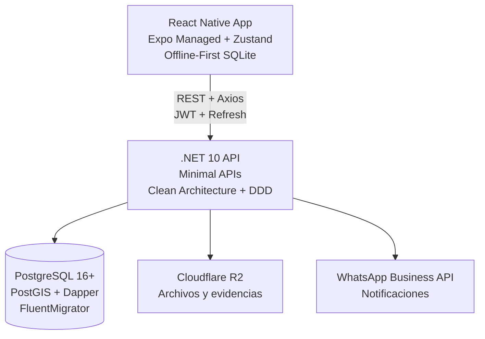

# UrbaPF - Sistema de Coordinación Vecinal

[](https://github.com/urba-pf/urba-pf/actions)
[](https://codecov.io/gh/urba-pf/urba-pf)
[](./docs/global-spec.md)
[](LICENSE)

Plataforma integral de gestión comunitaria diseñada para centralizar la seguridad, la comunicación y la democracia participativa en barrios y condominios de Santa Cruz, Bolivia.



## 🎯 Visión de Negocio

Digitalizar la convivencia vecinal reduciendo la fricción de los grupos de WhatsApp y profesionalizando la respuesta ante emergencias y la toma de decisiones.

**Objetivo v1.0.0**: Baseline de producción funcional con arquitectura robusta, auditable y móvil-first.

## 🏛️ Bounded Contexts (Dominio)

| Contexto | Entidades clave | Responsabilidad |
|----------|-----------------|-----------------|
| Identity & Access | User, RefreshToken, Role, CredibilityLevel | Auth JWT + Refresh, validación vecinal (2 votos), roles, credibilidad 1-5 |
| Governance | Poll, Vote, PollOption | Votaciones, firma SHA256, resultados inmutables |
| Communication | Post, Comment, PostCategory | Tablón social, comentarios anidados, moderación por credibilidad |
| Safety | Alert, Incident, AlertType | Emergencias geolocalizadas, workflow Reportado→Cerrado |
| Community | Condominium, Lot, Expense | Condominios, manzanos/lotes, expensas, cuotas |

## 🔐 Reglas de Gobernanza y Roles

| Acción | Visitante | Vecino | Guardia | Encargado | Admin |
|--------|-----------|--------|---------|-----------|-------|
| Ver publicaciones | ✅ | ✅ | ✅ | ✅ | ✅ |
| Ver emergencias | ✅ | ✅ | ✅ | ✅ | ✅ |
| Publicar | ❌ | ✅ | ❌ | ✅ | ✅ |
| Votar | ❌ | ✅ | ❌ | ✅ | ❌ |
| Crear votación | ❌ | 2 aprobaciones | ❌ | Directo | Gestiona |
| Botón "En Camino" | ❌ | ❌ | ✅ | ❌ | ❌ |
| Aprobar contenido | ❌ | ❌ | ❌ | ✅ | ✅ |
| Gestionar staff | ❌ | ❌ | ❌ | ❌ | ✅ |

### Niveles de Credibilidad (1-5)
- **5 Referente:** prioridad máxima, alertas directo a Guardias, máxima visibilidad.
- **4 Confiable:** alertas directo a Guardias, alta visibilidad.
- **3 Neutral:** aprobación Manager, visibilidad normal.
- **2 Bajo:** aprobación Manager, visibilidad reducida.
- **1 Irreverente:** aprobación Manager, comentarios colapsados/ocultos.

## 🗳️ Sistema de Votaciones

- **Votantes:** Solo Vecinos y Encargados. Admin gestiona pero no vota.
- **Creación:** Vecinos requieren 2 aprobaciones de Encargados; Encargados publican directo.
- **Integridad:** Firma digital SHA256 (`UserId + OptionId + Timestamp + Secret`) por voto.
- **Inmutabilidad:** Prohibido editar o eliminar votaciones en estado Active o Closed.

## 🚨 Protocolo de Emergencia

- **Ubicación:** Georeferencia obligatoria (PostGIS).
- **Routing por credibilidad:** Nivel >= 4 → directo a Guardias; < 4 → aprobación de Manager.
- **Re-notificación:** El creador puede re-enviar la alerta a todos los vecinos.
- **Workflow:** Reportado → En Proceso → Resuelto → Cerrado.

## 📐 Decisiones Clave de Arquitectura

1. **Clean Architecture + DDD (ligero):** Capas separadas `Domain` → `Application` → `Infrastructure` → `Api`. Domain no referencia ni Application ni Infrastructure.
2. **Application Layer ligera:** Application Services orquestran Domain Services. **Sin MediatR ni CQRS** (YAGNI).
3. **Sin EF Core:** Acceso a datos con **Dapper 2.1.72**; migraciones con **FluentMigrator 8.0.1**.
4. **Event Sourcing ligero:** Tabla `logs_eventos` append-only. Ningún estado crítico se actualiza sin insertar un evento en la misma transacción. Hash encadenado (`SHA256(prev_hash + event_json)`) para integridad.
5. **Seguridad:** PBKDF2 (HMAC-SHA256) con 100k iteraciones; JWT de corta vida + Refresh Token.
6. **Soft delete:** `UPDATE {table} SET deleted_at = CURRENT_TIMESTAMP WHERE id = @Id`.
7. **Frontend:** React Native (Expo Managed) + Zustand + Expo Router; offline-first con expo-sqlite + sync engine propio.
8. **Testing:** SDD + TDD. Backend: NUnit + Moq (Mock-First, sin DB real en unit tests). Frontend: Vitest + React Native Testing Library. Cobertura mínima 40%.
9. **Versionado:** SemVer 2.0 (`v{MAJOR}.{MINOR}.{PATCH}`).

## 🚀 Quick Start

### Prerrequisitos
- .NET 10 SDK
- Node.js 20+ / pnpm 9+
- PostgreSQL 16+ con PostGIS
- Expo CLI (`npm i -g @expo/cli`)

### Backend
```bash
cd backend
dotnet restore
dotnet run --project src/UrbaPF.Api
# API en http://localhost:5000
# Swagger en http://localhost:5000/swagger
```

### Frontend (React Native / Expo)
```bash
cd frontend
pnpm install
pnpm dev
# Expo DevTools en terminal, app en dispositivo/emulador
```

### Tests
```bash
# Backend (NUnit + coverage)
cd backend
dotnet test --collect:"XPlat Code Coverage"

# Frontend (Vitest + coverage)
cd frontend
pnpm test --coverage
```

## 📂 Estructura del Proyecto

```
backend/
├── src/
│   ├── UrbaPF.Domain/        # Núcleo puro: Entidades, VOs, Domain Services, Repository Interfaces
│   ├── UrbaPF.Application/   # Orquestación: Application Services, DTOs, Validators
│   ├── UrbaPF.Infrastructure/# Repositorios (Dapper), Migraciones, Servicios externos, Event Store
│   └── UrbaPF.Api/           # Presentación: Minimal APIs, Routes, DI, Middleware
└── tests/                    # Unit + Integration (Mock-First)
```

```
frontend/
├── app/                      # Expo Router (file-based routing)
│   ├── (auth)/               # Auth stack
│   ├── (tabs)/               # Main tabs
│   └── _layout.tsx
├── src/
│   ├── api/                  # Axios + interceptores 401/refresh
│   ├── store/                # Zustand stores
│   ├── hooks/                # Custom hooks (useOfflineSync, useAuth)
│   ├── components/           # UI reutilizable
│   ├── utils/                # Crypto, date, validation
│   ├── types/                # Tipos TypeScript
│   └── db/                   # SQLite offline engine + sync engine
```

## 📖 Documentación Detallada

- [Especificación Global](docs/global-spec.md) — Visión, bounded contexts, stack, principios, quick start, roadmap.
- [Módulos](docs/modules/) — Por dominio: `auth`, `polls`, `posts`, `alerts`, `users`, `condominiums`, `incidents`. Cada uno con `spec.md`, `plan.md`, `tests.md` (SDD).
- [AGENTS.md](AGENTS.md) — Fuente de verdad técnica para agentes de desarrollo (DDD, SDD, TDD, React Native, reglas de oro).

## 🇧🇴 Contexto Regional

Uso de terminología local: Manzano (Mza), Lote, Vobo, Expensas, Churrasquera, Portería.

## 📄 Licencia

MIT License
