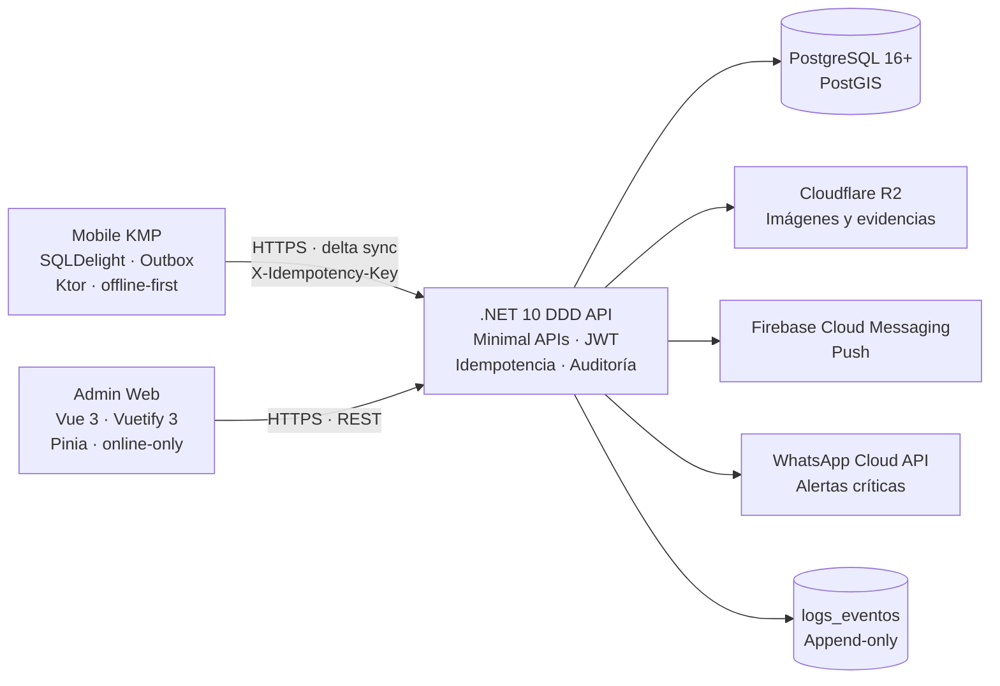

# UrbaPF

[](https://github.com/urba-pf/urba-pf/actions)
[](https://codecov.io/gh/urba-pf/urba-pf)
[](./docs/global-spec.md)
[](LICENSE)

Plataforma de coordinación vecinal para barrios y condominios de Santa Cruz, Bolivia. La v1.0.0 separa la operación de campo del trabajo administrativo: una app móvil **offline-first** para vecinos y guardias, y un panel web interno para gestión, finanzas y auditoría.

> Estado: este README documenta la arquitectura destino v1.0.0. La migración de código se ejecuta por fases después de aprobar `docs/` y `AGENTS.md`.

## Arquitectura



## Decisiones Clave de Arquitectura

### 1. Kotlin Multiplatform para el cliente de campo

KMP permite compartir dominio, persistencia SQLDelight, outbox y contratos de red entre Android e iOS, mientras la UI se implementa primero en Android. Es la opción adecuada para una operación con conectividad intermitente: cada mutación se guarda localmente antes de intentar la red y se reconcilia con idempotencia cuando el dispositivo recupera conexión.

### 2. Vue 3 + Vuetify 3 para el panel administrativo

El trabajo de oficina es online, intensivo en formularios, tablas y validación. Vue 3 + Vuetify 3 + TypeScript + Pinia + Vite ofrece un desarrollo rápido y consistente, con componentes accesibles y un ecosistema maduro. La migración desde Quasar conserva flujos funcionales, no la dependencia del framework anterior.

### 3. .NET 10 con DDD, SDD y SemVer 1.0.0

El backend mantiene una Application Layer ligera, Dapper y FluentMigrator, y separa dominio, aplicación, infraestructura y API. La documentación SDD (`spec.md`, `plan.md`, `tests.md`) es obligatoria antes de implementar. El contrato público se versiona desde `1.0.0` con SemVer 2.0; los cambios incompatibles exigen `MAJOR`.

### 4. Outbox, idempotencia y sync delta

El móvil no confirma nada sin respuesta del servidor. Un outbox durable, `X-Idempotency-Key`, `lastSyncTimestamp` y `serverSequence` evitan duplicados y permiten reanudar sin depender del reloj del dispositivo. Las imágenes se comprimen antes de subir a R2 y las respuestas de sync se negocian con Brotli/Gzip.

### 5. Sesiones separadas por canal

`WebAdmin` y `MobileApp` son sesiones independientes para un mismo usuario. Un login web no cierra la sesión móvil. Cada canal mantiene una única sesión activa y su propia familia de refresh tokens.

## Quick Start

### Prerrequisitos

- .NET 10 SDK
- JDK 21 y Android Studio (para KMP/Android)
- Xcode (solo macOS, para el host iOS)
- Node.js 20+ y pnpm 9+
- Docker y Docker Compose
- PostgreSQL 16+ con PostGIS (se puede usar el contenedor del proyecto)

### Base de datos

```bash
docker compose -f docker-compose.dev.yaml up -d db
```

### Backend

```bash
cd backend
dotnet restore
dotnet run --project src/UrbaPF.Api
# API: http://localhost:5000
# Swagger: http://localhost:5000/swagger
```

### Admin Web

```bash
cd admin-web
pnpm install
pnpm dev
# Admin: http://localhost:5173
```

> La carpeta `admin-web/` es el destino de la migración. El frontend Quasar actual permanece en `frontend/` hasta completar el traslado funcional.

### Mobile KMP

```bash
cd mobile-kmp
./gradlew :shared:allTests
./gradlew :androidApp:assembleDebug
# iOS (solo macOS): abrir mobile-kmp/iosApp en Xcode y ejecutar el scheme iOS.
```

### Tests

```bash
# Backend
cd backend
dotnet test --collect:"XPlat Code Coverage"

# Admin Web
cd admin-web
pnpm test --coverage
pnpm typecheck

# Mobile KMP
cd mobile-kmp
./gradlew :shared:allTests :androidApp:testDebugUnitTest
```

Cobertura mínima global: **40%**. Los tests unitarios del backend son Mock-First; PostgreSQL/PostGIS, R2 y proveedores externos se prueban en integración controlada.

## Bounded Contexts

| Contexto | Responsabilidad | Documentación |
|---|---|---|
| `auth-session` | Identidad, credenciales, roles, credibilidad y sesiones por canal. | [`spec`](docs/modules/auth-session/spec.md) · [`plan`](docs/modules/auth-session/plan.md) · [`tests`](docs/modules/auth-session/tests.md) |
| `governance-votes` | Votaciones, aprobaciones, votos firmados y resultados inmutables. | [`spec`](docs/modules/governance-votes/spec.md) · [`plan`](docs/modules/governance-votes/plan.md) · [`tests`](docs/modules/governance-votes/tests.md) |
| `emergencies` | Alertas geolocalizadas, guardias, incidentes, FCM y WhatsApp. | [`spec`](docs/modules/emergencies/spec.md) · [`plan`](docs/modules/emergencies/plan.md) · [`tests`](docs/modules/emergencies/tests.md) |
| `directory` | Comunidad, lotes, fichas, contactos y visibilidad. | [`spec`](docs/modules/directory/spec.md) · [`plan`](docs/modules/directory/plan.md) · [`tests`](docs/modules/directory/tests.md) |
| `expenses` | Gastos, cargos por lote, pagos, evidencias y conciliación. | [`spec`](docs/modules/expenses/spec.md) · [`plan`](docs/modules/expenses/plan.md) · [`tests`](docs/modules/expenses/tests.md) |

## Estructura del Proyecto

```text
backend/
├── src/
│   ├── UrbaPF.Domain/          # Entidades, VOs, servicios de dominio e interfaces
│   ├── UrbaPF.Application/     # Casos de uso, DTOs y validadores
│   ├── UrbaPF.Infrastructure/  # Dapper, migraciones, R2, FCM, WhatsApp
│   └── UrbaPF.Api/             # Minimal APIs, DI y middleware
└── tests/

mobile-kmp/
├── shared/                     # Dominio, SQLDelight, Ktor, sync e idempotencia
├── androidApp/                 # UI Android, cámara, ubicación y FCM
└── iosApp/                     # Host iOS

admin-web/
├── src/
│   ├── app/                    # Bootstrap y guards
│   ├── layouts/                # Layouts autenticados
│   ├── router/                 # Rutas y guards de rol
│   ├── stores/                 # Pinia por dominio
│   ├── services/               # Axios y endpoints
│   ├── components/             # Componentes Vuetify
│   ├── views/                  # Páginas por caso de uso
│   └── types/                  # Contratos API
└── vite.config.ts

docs/
├── global-spec.md
└── modules/{auth-session,governance-votes,emergencies,directory,expenses}/
```

## Seguridad y Auditoría

- PBKDF2 HMAC-SHA256 con 100.000 iteraciones.
- JWT de corta vida + refresh rotatorio; una sesión activa por usuario y canal.
- Autorización revalidada en servidor para cada caso de uso.
- Cloudflare R2 privado con URLs prefirmadas de corta duración.
- `logs_eventos` append-only con hash encadenado por comunidad.
- Sin tokens, contraseñas ni PII innecesaria en logs.

## Documentación

- [`docs/global-spec.md`](docs/global-spec.md): arquitectura, sync, seguridad, roadmap y Definition of Done.
- [`AGENTS.md`](AGENTS.md): instrucciones técnicas obligatorias para agentes y contribuidores.
- [`docs/modules/`](docs/modules/): especificación, plan y tests por bounded context.

## Licencia

MIT License. Ver [`LICENSE`](LICENSE).