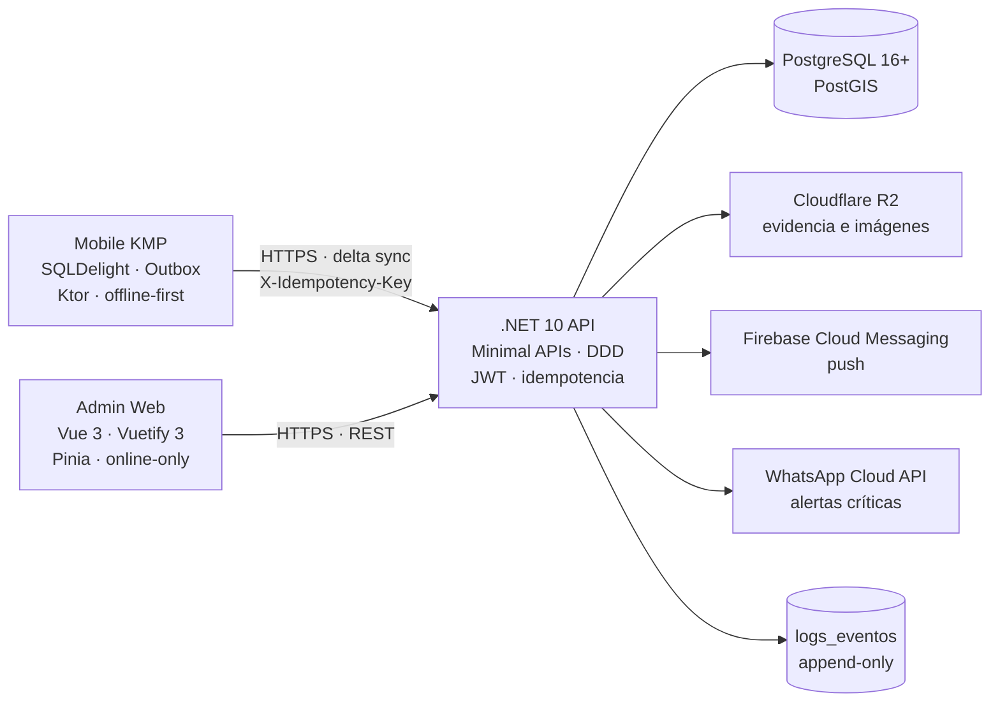

# UrbaPF — Especificación Global v1.0.0

> Estado: especificación aprobada para revisión de arquitectura.
> Alcance de este documento: definir el destino técnico y los contratos de integración antes de modificar código.
> Versión objetivo: **1.0.0** bajo SemVer 2.0.

## 1. Visión y objetivos

UrbaPF es una plataforma de coordinación vecinal para barrios y condominios de Santa Cruz, Bolivia. La v1.0.0 se compone de dos clientes especializados y un núcleo de dominio común:

1. **Mobile KMP** (`mobile-kmp/`): aplicación de campo para vecinos y guardias. Debe funcionar sin conectividad, con un outbox local de mutaciones y sincronización incremental.
2. **Admin Web** (`admin-web/`): panel interno para administración, validación de vecinos, finanzas, auditoría y reportes. Es una aplicación online, sin modo offline.
3. **Backend .NET 10**: API DDD con Application Layer ligera, acceso a datos Dapper, auditoría inmutable y contratos de sincronización idempotentes.

### Objetivos no funcionales

| Objetivo | Criterio v1.0.0 |
|---|---|
| Disponibilidad de campo | La app móvil puede registrar y encolar todas las mutaciones permitidas sin red. |
| Integridad | Ninguna mutación crítica se confirma sin transacción de negocio + evento de auditoría. |
| Idempotencia | Un reintento con la misma clave no duplica datos ni efectos externos. |
| Seguridad | JWT de corta vida, refresh rotatorio, una sesión activa por usuario y canal. |
| Bajo consumo | Sync incremental, compresión y compresión de imágenes en cliente. |
| Auditabilidad | `logs_eventos` es append-only y encadenado por hash. |
| Calidad | SDD + TDD; 40% de cobertura como mínimo global. |
| Versionado | API pública y contratos versionados desde `1.0.0` con SemVer 2.0. |

### No objetivos de v1.0.0

- Chat en tiempo real y marketplace.
- Modo offline del panel administrativo.
- Rewind del estado de dominio mediante replay de eventos. `logs_eventos` es un ledger de auditoría, no el event store transaccional del modelo.
- iOS completo en la primera entrega: la arquitectura debe ser iOS-ready, pero el QA funcional inicia en Android.

## 2. Contexto actual y migración

El repositorio contiene una base .NET con capas parcialmente separadas y un frontend Quasar que será el origen funcional del panel administrativo. La migración se realiza por fases y no debe romper contratos sin una versión mayor.

| Área | Estado actual | Destino v1.0.0 |
|---|---|---|
| Backend | `backend/Domain`, `backend/Infrastructure`, `backend/Api` y `backend/src/UrbaPF.Application` conviven parcialmente. | `backend/src/UrbaPF.{Domain,Application,Infrastructure,Api}` + `backend/tests`. |
| Admin | `frontend/` usa Quasar 2 + Vue 3 + Pinia + Vite. | Nuevo `admin-web/` con Vue 3 + Vuetify 3 + TypeScript + Pinia + Vite. |
| Móvil | No existe `mobile-kmp/`. | KMP con SQLDelight, Ktor, outbox y sincronización delta. |
| Datos | PostgreSQL + PostGIS y migraciones FluentMigrator. | Se conservan; se añaden idempotencia, sesiones por canal y checkpoints de sync. |
| Auditoría | `logs_eventos` existe. | Append-only, hash encadenado y eventos por los cinco bounded contexts. |

### Fases de implementación

| Fase | Entregable | Puerta de salida |
|---|---|---|
| 0 | Aprobación de esta documentación. | Specs, planes y tests revisados. |
| 1 | Backend DDD y contratos de sync. | Tests unitarios e integración Mock-First verdes; migraciones aplicadas. |
| 2 | Mobile KMP Android-first. | Offline, outbox, sync y push verificados en dispositivo/emulador. |
| 3 | Admin Web Vue 3 + Vuetify. | CRUD administrativo, validación, expensas y auditoría verificados. |
| 4 | Integración y piloto. | Idempotencia, recuperación ante fallos y runbooks validados. |
| 5 | Release `v1.0.0`. | Tag Git, changelog y documentación sin contradicciones. |

## 3. Arquitectura de clientes



### 3.1 Mobile KMP (`mobile-kmp/`)

**Stack obligatorio:** Kotlin Multiplatform, SQLDelight para persistencia local, Ktor Client para HTTP. UI Android-first; estructura iOS-ready.

Principios:

- La UI lee únicamente de SQLDelight; nunca hace una mutación directamente contra la API desde una pantalla.
- Toda mutación permitida crea primero una fila `pending_mutation` y aplica un estado local explícitamente marcado como pendiente.
- El outbox es durable: sobrevive a reinicios, pérdida de red y actualizaciones de la app.
- El sync es incremental y usa `lastSyncTimestamp` más un `serverSequence` opaco para evitar relojes inconsistentes.
- Las imágenes se comprimen en el dispositivo antes de subirlas a Cloudflare R2.
- Los tokens se guardan en almacenamiento seguro de plataforma; nunca en logs ni en SQLDelight sin cifrar.

Estructura objetivo:

```text
mobile-kmp/
├── shared/
│   └── src/
│       ├── commonMain/kotlin/com/urbapf/
│       │   ├── domain/                 # modelos y reglas compartidas
│       │   ├── data/local/             # SQLDelight, DAOs, outbox
│       │   ├── data/remote/            # Ktor, DTOs, auth interceptor
│       │   ├── sync/                   # delta pull + outbox push
│       │   └── di/                     # composición de dependencias
│       └── commonTest/kotlin/          # tests compartidos
├── androidApp/
│   └── src/                            # UI, cámara, geolocalización, FCM
├── iosApp/
│   └── iosApp/                         # host iOS, SwiftUI/Compose según fase
└── build.gradle.kts
```

### 3.2 Admin Web (`admin-web/`)

**Stack obligatorio:** Vue 3, Vuetify 3, TypeScript, Pinia y Vite. Migración desde Quasar conservando flujos funcionales, no componentes visuales.

Principios:

- Aplicación online; los formularios muestran estados de error y no prometen persistencia sin conexión.
- No usa service worker para mutaciones ni sincronización diferida.
- Acceso mediante sesión `WebAdmin`; la sesión móvil no se ve afectada por login/logout del panel.
- No requiere SSR, SEO ni internacionalización pública en v1.0.0.
- Las pantallas y tablas se basan en datos del servidor; el estado Pinia es caché de sesión, no una segunda fuente de verdad persistente.

Estructura objetivo:

```text
admin-web/
├── src/
│   ├── app/                 # bootstrap, providers, guards
│   ├── layouts/             # layouts autenticados
│   ├── router/              # rutas y guards de rol
│   ├── stores/              # Pinia: auth, directorio, gastos, auditoría
│   ├── services/            # Axios, endpoints, manejo de errores
│   ├── composables/         # reglas de UI reutilizables
│   ├── components/          # componentes Vuetify por contexto
│   ├── views/               # páginas por caso de uso
│   └── types/               # contratos API
├── index.html
├── package.json
└── vite.config.ts
```

## 4. Backend .NET 10

### 4.1 Capas y dependencias

```text
backend/
├── src/
│   ├── UrbaPF.Domain/          # Entidades, VOs, servicios de dominio,
│   │                           # eventos, interfaces de repositorio.
│   ├── UrbaPF.Application/     # Application Services, DTOs, validadores.
│   ├── UrbaPF.Infrastructure/  # Dapper, FluentMigrator, R2, FCM, WhatsApp.
│   └── UrbaPF.Api/             # Minimal APIs, DI, middleware.
└── tests/
    ├── UrbaPF.Domain.UnitTests
    ├── UrbaPF.Application.UnitTests
    └── UrbaPF.Api.IntegrationTests
```

Reglas inviolables:

1. `Domain` no referencia `Application` ni `Infrastructure`.
2. `Application` referencia solo `Domain`.
3. `Infrastructure` implementa interfaces definidas en `Domain`.
4. `Api` referencia `Application` e `Infrastructure` únicamente para composición/DI.
5. No se usa EF Core. El acceso transaccional usa Dapper.
6. Migraciones con FluentMigrator sobre PostgreSQL + PostGIS.
7. Application Services orquestan casos de uso y devuelven DTOs; no exponen entidades.
8. Sin MediatR ni CQRS en v1.0.0.
9. Los controladores/Route handlers no contienen reglas de negocio.
10. Los tests unitarios son Mock-First; la base de datos real solo se usa en pruebas de integración controladas.

### 4.2 Concurrency y versiones de agregado

Toda entidad modificable expone `version` entero y `updated_at`. Las mutaciones enviadas por el cliente incluyen `baseVersion` cuando actualizan un agregado existente.

- Si `baseVersion` no coincide, la API responde `409` con `errorCode = VERSION_CONFLICT`.
- El cliente conserva la mutación en estado `conflict` y muestra una resolución explícita; no sobrescribe silenciosamente.
- Las creaciones offline usan un UUID generado en cliente (UUIDv7 recomendado) para permitir deduplicación antes de que el servidor asigne un ID definitivo.

## 5. Contrato de sincronización delta

### 5.1 Modelo de outbox móvil

Tabla local mínima:

```sql
CREATE TABLE pending_mutation (
  mutation_id      TEXT PRIMARY KEY,       -- idempotency key UUID
  entity_type      TEXT NOT NULL,
  entity_id        TEXT NOT NULL,
  operation        TEXT NOT NULL,          -- create | update | delete
  aggregate_version INTEGER,
  payload_json     TEXT NOT NULL,
  client_created_at TEXT NOT NULL,
  state            TEXT NOT NULL,          -- pending | in_flight | retry | conflict | rejected | applied
  attempts         INTEGER NOT NULL DEFAULT 0,
  next_attempt_at  TEXT,
  last_error       TEXT
);
```

Reglas:

- Una mutación se persiste en `pending_mutation` antes de confirmar cualquier cambio optimista en la UI.
- La UI puede renderizar el cambio como “pendiente”, pero nunca como confirmado por el servidor.
- Para un mismo `entity_type + entity_id`, las mutaciones se envían en orden FIFO. Mutaciones de agregados distintos pueden ir en paralelo con concurrencia máxima configurable (recomendado: 3).
- `in_flight` se marca antes de la red y vuelve a `retry` si el proceso termina sin respuesta confirmada.
- Backoff exponencial con jitter. Los errores de autenticación pausan el outbox; los errores de validación no se reintentan automáticamente.
- La cola no se borra al cerrar sesión; se archiva y se descarta solo tras una confirmación explícita del usuario o una política de retención documentada.

### 5.2 Cabeceras y deduplicación

Toda mutación autenticada incluye:

```http
Authorization: Bearer <access-token>
X-Channel: MobileApp
X-Idempotency-Key: <uuid-v4-o-v7>
X-Client-Version: 1.0.0
X-Schema-Version: 1
Content-Encoding: br
```

- `X-Idempotency-Key` es obligatoria en POST/PATCH/PUT que crean o cambian estado.
- La clave es única por `community_id + user_id + channel + idempotency_key`.
- El servidor guarda hash del request. Si llega la misma clave con otro payload, responde `409 IDEMPOTENCY_KEY_REUSED`.
- Si llega la misma clave con el mismo payload, devuelve la respuesta original sin repetir efectos.
- Registros de idempotencia vencen después de 24 horas; el cliente conserva confirmaciones locales durante al menos 7 días.

### 5.3 Push del cliente

```http
POST /api/v1/sync/push
```

Request:

```json
{
  "mutations": [
    {
      "mutationId": "0197f2c0-...",
      "entityType": "expense.payment",
      "entityId": "0197f2b0-...",
      "operation": "create",
      "baseVersion": null,
      "clientCreatedAt": "2026-11-12T20:15:00-04:00",
      "payload": {}
    }
  ]
}
```

Response:

```json
{
  "serverTimestamp": "2026-11-12T20:15:03Z",
  "results": [
    {
      "mutationId": "0197f2c0-...",
      "status": "applied",
      "entityVersion": 7,
      "serverEntityId": "0197f2b0-..."
    }
  ]
}
```

Estados de resultado: `applied`, `duplicate`, `conflict`, `rejected`, `retryable`.

Reglas:

- El push es una transacción por mutación, no una transacción global: una mutación inválida no bloquea las demás.
- El servidor aplica una mutación por agregado en orden recibido.
- La respuesta incluye siempre `serverTimestamp` y `serverSequence` para actualizar el watermark.
- `retryable` se reintenta; `rejected` requiere corrección del usuario; `conflict` requiere resolución explícita.

### 5.4 Pull del servidor

```http
GET /api/v1/sync/delta?lastSyncTimestamp=2026-11-12T18:00:00Z&collections=auth,directory,governance,emergencies,expenses
Accept-Encoding: br, gzip
```

Response:

```json
{
  "serverTimestamp": "2026-11-12T20:15:03Z",
  "serverSequence": 18432,
  "hasMore": false,
  "collections": {
    "directory": {
      "items": [],
      "deleted": [],
      "nextCursor": null
    }
  }
}
```

Reglas:

- El watermark del cliente guarda `lastSyncTimestamp` y `serverSequence`; el timestamp nunca se toma del reloj del dispositivo.
- Solo se envían registros `updated_at > lastSyncTimestamp`, incluyendo borrados lógicos (`deleted_at`).
- Paginación por colección con `nextCursor`; `hasMore = true` obliga a repetir el pull antes de marcar el watermark como seguro.
- El servidor aplica un solapamiento de 5 minutos para tolerar relojes y confirmaciones tardías; la deduplicación se hace por ID/version.
- La respuesta se comprime con Brotli o Gzip mediante negociación HTTP.
- El cliente escribe el lote en una transacción SQLDelight y luego actualiza el watermark.

### 5.5 Resolución de conflictos

| Caso | Regla |
|---|---|
| Voto duplicado | Gana el primero confirmado; reintentos idempotentes devuelven el mismo resultado. |
| Encuesta cerrada antes de sincronizar | `409 POLL_CLOSED`; el voto local pasa a `rejected` con motivo visible. |
| Actualización de directorio | Gana el servidor si hay `VERSION_CONFLICT`; el admin debe recargar y reintentar. |
| Pago de expensa | Gana el servidor para monto, estado y conciliación; el cliente nunca fija el estado final. |
| Emergencia | Gana el servidor para estado operativo; la creación offline se encola y se confirma al sincronizar. |
| Metadatos editables del perfil | Última versión válida gana, con auditoría; se muestra `baseVersion`. |

### 5.6 Comprensión del “100% offline”

El 100% offline se refiere a la capacidad de capturar, persistir y encolar la operación, y de leer datos cacheados. No implica que una notificación externa pueda entregarse sin red. Una emergencia creada offline se marca `pending_sync`; al recuperar conectividad se sincroniza y solo entonces se envían FCM/WhatsApp. La UI debe indicar “pendiente de envío”, no “emergencia confirmada”.

## 6. Seguridad

### 6.1 Autenticación y sesiones por canal

- Contraseñas: PBKDF2 HMAC-SHA256, 100.000 iteraciones, sal por usuario.
- Access token JWT de corta vida (recomendado: 15 minutos).
- Refresh token de larga vida, rotación obligatoria en cada uso.
- Detección de reuso: revocación de toda la familia de tokens.
- Una sesión activa por usuario **por canal**: `WebAdmin` y `MobileApp` son independientes.
- Un nuevo login `MobileApp` revoca la sesión móvil anterior; un login `WebAdmin` no afecta la sesión móvil.
- Logout revoca la familia del canal actual.
- La API rechaza un token sin claim `channel` o con un canal no permitido por la ruta.

### 6.2 Autorización

La autorización se evalúa en servidor por caso de uso. El cliente solo aplica reglas para UX. Roles base: `Visitante`, `Vecino`, `Guardia`, `Encargado`, `Admin`.

| Acción | Visitante | Vecino | Guardia | Encargado | Admin |
|---|---:|---:|---:|---:|---:|
| Ver directorio básico | — | ✅ | ✅ | ✅ | ✅ |
| Publicar contenido vecinal | — | ✅ | — | ✅ | ✅ |
| Votar | — | ✅ | — | ✅ | — |
| Crear votación | — | 2 aprobaciones | — | Directo | Gestiona |
| Recibir alertas críticas | — | Según credibilidad | ✅ | Según credibilidad | ✅ |
| Botón “En Camino” | — | — | ✅ | — | — |
| Aprobar contenido | — | — | — | ✅ | ✅ |
| CRUD de expensas | — | — | — | Lectura | ✅ |
| Gestionar staff | — | — | — | — | ✅ |

La matriz definitiva por endpoint se documenta en cada `spec.md`.

### 6.3 Credibilidad

| Nivel | Nombre | Emergencias | Visibilidad |
|---:|---|---|---|
| 5 | Referente | Directo a guardias, prioridad máxima | Máxima |
| 4 | Confiable | Directo a guardias | Alta |
| 3 | Neutral | Requiere aprobación de manager | Normal |
| 2 | Bajo | Requiere aprobación de manager | Reducida |
| 1 | Irreverente | Requiere aprobación de manager | Comentarios colapsados |

### 6.4 Datos, archivos y canales externos

- Cloudflare R2 almacena imágenes/evidencias mediante URLs prefirmadas de corta duración.
- El cliente comprime imágenes antes de subir: máximo recomendado 1600 px, JPEG/WebP y objetivo < 1 MB por imagen.
- FCM envía push por condominio/rol; el token del dispositivo se asocia a usuario y canal.
- WhatsApp Cloud API se usa para alertas críticas. El envío es asíncrono y queda registrado con estado `queued | sent | delivered | failed`.
- Los mensajes de WhatsApp no incluyen datos sensibles innecesarios.
- Nunca se registran access tokens, refresh tokens, payloads de autenticación ni números completos en logs estructurados.

## 7. Auditoría inmutable

### 7.1 Esquema objetivo

```sql
CREATE TABLE logs_eventos (
  id BIGSERIAL PRIMARY KEY,
  uuid UUID NOT NULL UNIQUE DEFAULT gen_random_uuid(),
  comunidad_id UUID NOT NULL,
  usuario_id UUID NOT NULL,
  session_id UUID,
  tipo_evento VARCHAR(100) NOT NULL,
  entidad_id UUID NOT NULL,
  data_json JSONB NOT NULL,
  hash_anterior TEXT,
  hash_verificacion TEXT NOT NULL,
  fecha TIMESTAMPTZ NOT NULL DEFAULT CURRENT_TIMESTAMP
);

CREATE INDEX ix_logs_eventos_comunidad_fecha
  ON logs_eventos (comunidad_id, fecha DESC);
CREATE INDEX ix_logs_eventos_entidad
  ON logs_eventos (entidad_id, fecha DESC);
```

Restricciones:

- `UPDATE` y `DELETE` están prohibidos para todos los roles de aplicación. Solo procesos de migración controlados pueden tocar la tabla.
- El hash se calcula como `SHA256(hash_anterior || canonical_json(data_json))`.
- El `hash_anterior` es el `hash_verificacion` del evento inmediatamente anterior de la misma comunidad.
- Cada evento se escribe en la misma transacción que la mutación de negocio.
- Si la verificación de cadena falla, el sistema genera una alerta de integridad y bloquea reportes de auditoría hasta la revisión.

### 7.2 Eventos por bounded context

| Contexto | Eventos |
|---|---|
| `auth-session` | `USER_REGISTERED`, `USER_VALIDATED`, `ROLE_CHANGED`, `CREDIBILITY_UPDATED`, `LOGIN`, `LOGOUT`, `TOKEN_REFRESHED`, `TOKEN_REUSE_DETECTED`, `SESSION_REVOKED`, `PASSWORD_CHANGED` |
| `governance-votes` | `POLL_CREATED`, `POLL_APPROVED`, `POLL_ACTIVATED`, `POLL_CLOSED`, `VOTE_CAST`, `POLL_RESULT_FINALIZED` |
| `emergencies` | `EMERGENCY_CREATED`, `EMERGENCY_APPROVED`, `EMERGENCY_REJECTED`, `GUARD_EN_ROUTE`, `EMERGENCY_RESOLVED`, `EMERGENCY_CLOSED`, `INCIDENT_CREATED`, `INCIDENT_STATUS_UPDATED`, `NOTIFICATION_FAILED` |
| `directory` | `CONDOMINIUM_CREATED`, `LOT_CREATED`, `DIRECTORY_ENTRY_CREATED`, `DIRECTORY_ENTRY_UPDATED`, `DIRECTORY_ENTRY_DELETED`, `ROLE_ASSIGNED` |
| `expenses` | `EXPENSE_CREATED`, `EXPENSE_UPDATED`, `EXPENSE_PAID`, `PAYMENT_CONFIRMED`, `PAYMENT_REJECTED`, `EXPENSE_REMINDER_SENT` |

## 8. Contratos HTTP globales

- Prefijo: `/api/v1`.
- Errores: RFC 7807 (`application/problem+json`) con `errorCode` estable y `traceId`.
- Paginación: cursor opaco, límite máximo 100.
- Fechas: ISO 8601 UTC en API; la UI formatea localmente.
- IDs: UUID en API; UUIDv7 recomendado para agregados creados offline.
- Compresión: Brotli/Gzip para sync y colecciones grandes.
- Soft delete: `deleted_at` y `deleted_by`; las consultas activas filtran borrados salvo auditoría.
- Idempotencia: obligatoria en mutaciones móviles; opcional pero recomendada en mutaciones administrativas.
- Rate limit: por usuario/IP para auth y creación de emergencias.

## 9. SDD, TDD y SemVer

### 9.1 Documentación obligatoria

Cada bounded context contiene `spec.md`, `plan.md` y `tests.md`:

- `spec.md`: propósito, entidades, reglas, casos de uso, contratos, errores y edge cases.
- `plan.md`: tareas, dependencias, migraciones, estrategia de pruebas y estimación.
- `tests.md`: escenarios Given/When/Then, matriz de cobertura y criterios de aceptación.

Ninguna tarea de código inicia sin los tres documentos aprobados.

### 9.2 Ciclo TDD

1. **Red**: test que falla, alineado a `tests.md`.
2. **Green**: implementación mínima.
3. **Refactor**: diseño y nombres, manteniendo tests verdes.

Cobertura mínima global: **40%**. Los tests unitarios de dominio no usan base de datos real; los tests de repositorio/R2/FCM/WhatsApp usan dobles o contenedores de integración controlados.

### 9.3 SemVer 2.0

Baseline: `1.0.0`.

- `MAJOR`: cambio incompatible en ruta, payload, semántica de error, autenticación o esquema sin migración compatible.
- `MINOR`: funcionalidad retrocompatible o colección/endpoint nuevo.
- `PATCH`: corrección retrocompatible.

Los contratos de sync son parte de la API pública. Agregar campos opcionales es `MINOR`; cambiar el significado de `lastSyncTimestamp`, `mutationId` o `X-Idempotency-Key` es `MAJOR`.

## 10. Estructura documental y trazabilidad

```text
docs/
├── global-spec.md
└── modules/
    ├── auth-session/
    ├── governance-votes/
    ├── emergencies/
    ├── directory/
    └── expenses/
```

Cada módulo referencia este documento. Si hay conflicto, prevalece la especificación global para contratos transversales y el `spec.md` del módulo para reglas de negocio específicas, siempre que no contradiga seguridad o auditoría.

## 11. Definition of Done de la migración

La migración no está terminada hasta que:

- Las cinco carpetas de módulo tengan spec, plan y tests aprobados.
- El backend compile y pase pruebas con cobertura mínima.
- El outbox móvil sobreviva a reinicio, red intermitente y reintentos duplicados.
- El pull delta no pierda ni duplique registros tras paginación.
- `WebAdmin` y `MobileApp` mantengan sesiones independientes.
- `logs_eventos` rechace updates/deletes y verifique su cadena.
- El admin Vue 3 + Vuetify cubra los flujos administrativos críticos.
- README, AGENTS y specs no contengan instrucciones contradictorias.
- El release esté etiquetado como `v1.0.0`.